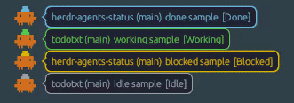

# herdr-agents-status

Always-on-top transparent overlay showing coding-agent status from [Herdr](https://herdr.dev) (TUI) and the Herdr desktop app / herdr-core (`hc`).

It watches agents from the outside, and when both are running they are merged into one list.

Spiritual successor to [claudeye](https://github.com/maedana/claudeye), built for Herdr instead of tmux.



Agents waiting for you (`Blocked`) or finished (`Done`) hop up and down, so they stand out at a glance.
Rows are ordered like Herdr's `priority` agent panel — `Blocked`, `Done`, `Working`, then `Idle` — and idle agents are dimmed.

## Install (Herdr TUI)

```bash
herdr plugin install maedana/herdr-agents-status
```

### From source

```bash
git clone https://github.com/maedana/herdr-agents-status
cd herdr-agents-status
cargo build --release
herdr plugin link .
```

## Usage

```bash
herdr plugin action invoke toggle --plugin maedana.agents-status
```

Running the command again toggles the overlay off.

### Keybinding (recommended)

Add to `~/.config/herdr/config.toml`:

```toml
[[keys.command]]
key = "prefix+o"
type = "shell"
command = "herdr plugin action invoke toggle --plugin maedana.agents-status"
description = "agents status overlay"
```

## Herdr desktop app (herdr-app)

Build the binary and put it on your `PATH`:

```bash
git clone https://github.com/maedana/herdr-agents-status
cd herdr-agents-status
cargo install --path .
```

Install the launcher mod. It is copied into `~/.config/herdr-app/mods` (or `$HERDR_APP_HOME/mods`):

```bash
./herdr-app/install.sh
```

Then bind it in herdr-app's `keys.json`:

```json
{ "global": { "ctrl-t o": "mod.open:agents-status" } }
```

Pressing the key again hides the overlay.
To pass extra arguments such as `--config`, edit `ARGS` in `herdr-app/mods/agents-status/main.js` of your clone
(e.g. `const ARGS = ["--config", "/path/to/config.toml"];`) and run `./herdr-app/install.sh` again
(the installed copy is overwritten on every install, so edit the clone, not the installed copy).

The mod starts it through your login shell as an interactive shell (`$SHELL -ic`), the way herdr-core starts terminals,
so `herdr-agents-status`, `hc` and `herdr` are found on the same `PATH` as in a terminal
(including tools set up in your shell's rc file, such as mise).
Agents are the terminals that report a status.

You can also run `herdr-agents-status` directly (e.g. from a desktop shortcut). Running it again toggles it off.

## Configuration

The config file is looked up in this order:

1. `--config <path>` (or `--config=<path>`)
2. The Herdr plugin config dir, `~/.config/herdr/plugins/config/maedana.agents-status/config.toml` (resolved with `herdr plugin config-dir maedana.agents-status`)
3. Built-in defaults

An explicit `--config` that is missing, unreadable or invalid exits with an error (code 2).

Example `config.toml`:

```toml
position = "top-right"
sessions = "all"
```

### `position`

- `top-left`, `top-center` (default), `top-right`
- `middle-left`, `middle-center`, `middle-right`
- `bottom-left`, `bottom-center`, `bottom-right`

### `sessions`

Which Herdr (TUI) sessions to show agents from. This applies only to Herdr sessions; herdr-core agents are always all shown.

- `all` (default) — every running session, merged into one list
- `current` — only the session the overlay was launched from
